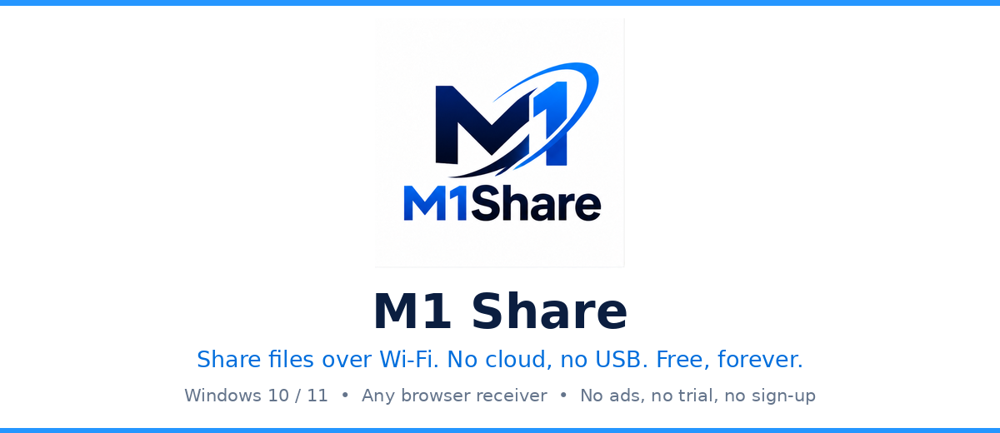

<div align="center">



# M1 Share

**Share files over Wi-Fi. No cloud, no USB. Free, forever.**

🌐 **github.com/mobasherul1/m1share** — the official page, with the downloads, help, and news

[**⬇ Download v1.0.0 — Latest**](https://github.com/mobasherul1/m1share/releases)

> Release coming soon — no signed exe yet. v1.0.0 source is in this repo, built by GitHub Actions. Build it yourself for now — see [Build from source](#build-from-source).

⭐ **Like it? Give it a star.** M1 Share has no ads and no marketing budget — stars are how people find it.

Windows 10 / 11 · Any browser receiver · No ads, no trial, no sign-up

> **Version 1.0.0 — Release v1.0.0 — Windows (sender)**
> Created by [Md. Mobasherul Hasan](https://bd.linkedin.com/in/mobasherul1) · © 2026 Md. Mobasherul Hasan. All rights reserved.

</div>

**Offline LAN file sharing — no internet, no upload, no sign-up, no cloud.**

M1 Share is a small Windows app that turns your own PC into a private Wi-Fi file server. Once it's running, anyone whose phone, tablet or computer is on the SAME Wi-Fi / router can open a simple link in their browser, pick the files they want, and download them straight from YOUR computer — with no internet, no cloud account, no upload, and no USB drive.

Think of it as the easiest way to hand files from one PC to other devices in the same room, the same office floor, or the same home — especially when the files are too big for email, too many for a chat app, or too private to put on someone else's cloud.

Live site: https://m1share.netlify.app/
Source code: https://github.com/mobasherul1/m1share
License: MIT — free to use, share, and build from source.

---

## Interface — what readers see

| Sender app (Windows) | Sender panel (`/sender`) | Receiver page |
|---|---|---|
| Small "M1 Share" window with your share link, Copy link, Sharing ON/OFF, Add folder, live events | Full browser dashboard: share link + login code, file browser with tick boxes, Live user checker, recent activity | Any browser, any OS: enter name, enter code if set, browse ticked files, Download ticked / Download all files |

Preview the exact UI in this repo — no install needed to look:
- Sender UI: [sender/index.html](sender/index.html) — v48 clean (STABLE, 11 Nov 2026)
- Receiver UI: [receiver/index.html](receiver/index.html) — v14 clean (STABLE, 11 Nov 2026)
- Logo: [logos/m1share-logo-stacked.png](logos/m1share-logo-stacked.png) — original colours, white background

## What it does

### The sender app window

- Shows your share link (`http://<your-PC-ip>:8000/`) — big, clear, and ready to send.
- "Copy link" button copies it to the clipboard.
- One-click "Sharing ON / OFF" switch: off = nobody can open or download anything, instantly.
- "Add folder..." opens a normal Windows folder picker — pick any folder and it becomes shared.
- Live events list: names of people saving names, opening the share, entering wrong codes, downloading files, blocking events — shown as they happen.
- If receivers can't connect, the window reminds you about Windows Firewall.

### The sender panel — full control page at `/sender` (this PC only)

**Share link card**
- The same share link, a Copy link button, and an address / port readout. A link to "Open the receiver page" in a new tab.
- Login code section right below.

**Login code**
- Toggle the login code ON or OFF.
- Code length: 3 digit, 4 digit, 5 digit, or Custom (type your own, up to 8 characters).
- Character sets: Digit / Alphabet / Special character — any combination is allowed.
- "Generate new code" makes a fresh random code instantly.
- Receivers cannot open anything until they type the code. Wrong codes are rate-limited: 10 wrong tries per 5 minutes per device, plus a global ceiling.

**Sharing card (the file browser)**
- Lists every folder you added as "main folder" chips — switch between them with one click.
- Navigable folder tree: open folders, go back, breadcrumb path.
- Every file and folder has a TICK BOX. Ticked = shared. Unticked = invisible to receivers. Unticking a folder unticks everything inside it; mixed selection shows a partial mark.
- Select all / Clear selection / Invert for the current folder.
- "Select files of size" — tick every file above (or below) any size, in MB or GB (e.g. "share everything above 4 GB" or "share everything below 500 MB").
- Selection summary: how many files of how many, how many GB, and how many folders are fully included.

**Sharing on/off card**
- Status row with a switch that works the same as the app window.
- "Receiver options" for downloads:
  - Single file — receivers only get "Download ticked" (the files they ticked, one by one).
  - All files — receivers only get "Download all files" (everything shared, main-folder files first).

**Live user checker**
- Every receiver who saves their name shows up here with their IP address, what they're doing ("Viewing files", "Downloading files"), and whether they're active now or idle.
- Block / unblock button next to each name. A blocked receiver is booted out immediately and even the right code will not let them back in until you unblock them.
- "Check now" refreshes the list on demand.

**How receivers connect + Recent activity**
- A 4-step how-to for the people you share with.
- A rolling log of recent events (who joined, who downloaded what).
- About us — links to the author, the GitHub repo, and the release version.

### The receiver page — what friends / family see at the link

Designed so a non-technical person can use it without help:
- They open the link in ANY browser (phone, laptop, tablet, any OS).
- Enter their name — the sender sees it appear in the Live user checker.
- If you set a login code, they see a code box next — wrong code = "Kindly get the code form sender". Right code = files open.
- Files screen: a folder browser of everything YOU ticked. Navigate with back button and breadcrumb, sort by name / size / date.
- Every file/folder has a tick box. Untick what they don't want.
- "Download ticked" or (if you set All files mode) "Download all files". Downloads arrive ONE FILE AT A TIME, main folder files first, then sub-folder files — every file arrives as itself. **There is NO ZIP option, ever.**
- Bottom of the page: an "How downloading works" guide, an About section, and the release version.
- If you turn sharing OFF while they're browsing, they are booted to a "Sharing is off" screen automatically. The page watches and lets them back in when it comes back.
- If you block them or turn the login code ON mid-visit, they are booted to a re-login screen automatically.
- No account, no app to install, no sign-up of any kind.

### Download order

Downloads always run in this order:
1. All files sitting directly in the main folder(s) first.
2. Then files inside sub-folders, one level deep.
3. Then files inside sub-sub-folders, and so on.

Each file downloads as itself — never packed into an archive — and each file appears in the receiver's downloads with its own name and size.

## Why use it

1. **Your files never leave your network.** No cloud upload, no third-party server, no account. The receiver's browser talks directly to YOUR PC over your own Wi-Fi. Nothing goes to the internet.
2. **Free and ask-nothing.** Free (MIT license). No subscription, no sign-up, no QR code pairing. Open the exe, send the link.
3. **Handles huge files email cannot.** Share a 40 GB wedding-video folder or a 100 GB game dump the same way you'd share a 2 MB PDF — the only limit is your Wi-Fi speed and your PC's disk.
4. **Privacy by default.** Only the folders you explicitly add are visible, and only the files you explicitly tick. Everything else on your PC is invisible.
5. **Sender stays in control.** You see WHO is connected and WHERE they are. You can block anyone mid-session, close the share with one click, require a code, change the code at any time.
6. **Nothing to install on the receiver side.** Receivers need nothing but a browser — no drivers, no apps, no accounts. Works on any device that can open a web page.
7. **One person prepares, everyone benefits.** One person runs the exe; 5, 10 or 50 people download from it at once on the same Wi-Fi.
8. **Faithful to old-school file sharing — but usable.** Windows' built-in network sharing is famously hostile. M1 Share gives you the same outcome — "here are my files" — in three clicks.
9. **Does not phone home.** No telemetry, no analytics, no update checks, no ads. The exe is a small, auditable codebase (a single Python file plus two web pages), open source under MIT.
10. **Fits real scenarios:** moving game/mod files at a LAN event, sharing a course pack with 40 students in one lab with no internet, giving a client deliverables in your office without hosting anything online, sharing the family photo library while visiting relatives, handing a friend a 15 GB folder on office Wi-Fi without a USB drive.

## Better than

- **USB flash drive:** no carrying, no virus risk, works for everyone at once.
- **Email attachments:** no 20 MB limit, no "attachment too large" bounce.
- **Cloud (Drive etc.):** no internet needed, no upload wait, no privacy concerns, works offline entirely.
- **AirDrop / ShareIt:** cross-platform by default (Windows sender, any browser receiver), no pairing screens, no app.
- **SMB / network share:** no drive mapping, no network-profile setup, no credentials dialog on the receiver.
- **FTP server:** no separate FTP client, no port forwarding, no file-permission headaches.
- **ZIP via USB/email:** no ZIP building time, no archive extraction — files arrive as normal files.

## How to use it — Sender

1. **Run it.** Double-click `M1 Share.exe`. A small window opens with the logo, your share link (e.g. `http://192.168.0.110:8000/`) and your address + port.
2. **If Windows Firewall asks.** Allow it (private networks is fine). If receivers still can't connect, allow "M1 Share" through Windows Defender Firewall, or run it once as administrator. The window itself reminds you of this.
3. **Pick what to share.** Click "Sender panel (control)" in the app window (or open `http://<your-pc-ip>:8000/sender` in a browser ON THIS PC). Click "Add folder" — the folder appears as a green chip, and its files appear in the browser. Repeat to share more than one folder.
4. **Tick the files to share.** Tick individual files/folders, or "Select all". Use "Select files of size" if you want only big (or only small) files. UNTICK anything you DON'T want shared — receivers will never see them.
5. **Optionally set a login code.** Toggle "Add login code" ON (it's on by default). Choose 3/4/5 digit or Custom, choose digits/letters/special characters, tap "Generate new code", or type one yourself (up to 8 characters, auto-uppercase). Send this code out of band to people you trust.
6. **Send the link.** Copy the link and send it over WhatsApp / email / text / say it out loud.
7. **Watch who joins.** The app window shows a live events log. The panel's Live user checker shows each person's name, IP, and status ("Active now" or "Idle"). Block anyone you don't want.
8. **When you're done.** Click "Sharing OFF" or just close the M1 Share window. Receivers will find the share closed; the files never left your network and nothing was ever uploaded.

Settings live in `%APPDATA%\M1Share\state.json` and survive restarts. You can switch download mode, turn the login code on/off, generate a brand-new code, block/unblock receivers, and add or remove shared folders at any time.

## How to use it — Receiver

1. Connect to the same Wi-Fi / router. This is the ONLY requirement. No internet needed.
2. Open the link the sender gave you, in any browser.
3. Enter your name (up to 40 characters). The sender sees it in their Live user checker.
4. If the sender set a code, enter the login code exactly as given (letters are case-insensitive). Wrong code = "Kindly get the code form sender". Right code = the files open.
5. Browse and tick what you want. Open folders, go back, sort by name/size/date. Tick only the files you want, or tick whole folders.
6. Download. Tap "Download ticked" (or "Download all files" in All files mode). Files download ONE AT A TIME, in order: main-folder files first, then sub-folder files. Your browser may ask "allow multiple downloads?" — choose Allow. Big files: keep the tab open until they finish. If one fails, just tap it again.

If something feels wrong: "Sharing is off" = sender closed the share; "You are blocked..." = sender blocked you; "Your session was closed" = sender turned the login code ON or generated a new one; "Too many wrong codes" = wait 5 minutes; Download 403 / "not shared" = sender unticked that file.

## FAQ

- **Does it work without the internet?** Completely. Nothing is uploaded anywhere.
- **Can receivers see OTHER files on my PC?** Never. Only the folders you add appear, and only the files you tick inside them.
- **How many people can download at once?** Dozens at the same time. A small Wi-Fi network saturates long before the app does.
- **Is there a size limit?** No file size limit and no total limit. Speed = your Wi-Fi's speed. 100 GB total is fine.
- **Does the sender's PC need to stay on?** Yes — the PC and the M1 Share window must stay open while people download.
- **What if two main folders are shared?** Multiple main folders show as a row of chips above the file browser on the receiver page. Tap a chip to switch.
- **Why does the receiver page say "Release v1.0.0"?** That's this software's version.
- **Can a blocked user get back in with a different name?** Yes — blocking is by name, by design (there are no accounts). Add their new name to the block list too.
- **Are my files uploaded anywhere if I turn sharing on?** Never.
- **Does the sender's PC get a firewall warning?** Possibly the first run. Allow it once and Windows won't ask again.
- **What happens to an in-flight download if the sender hits Sharing OFF?** Bytes already being sent finish arriving, but every new request is refused after that point.
- **Can receivers resume a half-downloaded file?** No — this server does not implement HTTP range requests. If a download dies halfway, download it again from the start.
- **Does the file list refresh live when I change files on disk?** No — the tree rebuilds on every tick/untick/add/remove and on restart.
- **Which ports does it use?** One port, default 8000. If 8000 is busy it tries 8001, 8002... up to 8010. The app window always shows the real address + port.
- **Where are my settings stored?** `%APPDATA%\M1Share\state.json`. Delete it to reset everything.
- **The antivirus / SmartScreen grumbles about the exe.** The exe is new and unsigned. Windows SmartScreen shows "unknown publisher" for brand-new unsigned software. The code is open source on GitHub — build it yourself in one command (see below) and verify it. A signed release lands on the GitHub Releases page once the project's SignPath approval completes.

Full ultra-detailed guide: [docs/M1_Share_Ultra_Detailed_Guide.txt](docs/M1_Share_Ultra_Detailed_Guide.txt)

## Security & privacy

**What protects you**
- LAN only. It never punches a hole in your router, no port forwarding, no UPnP, no internet exposure.
- Sender panel (`/sender` and `/api/sender/*`) answers from THIS PC ONLY — the rest of the Wi-Fi cannot reach it.
- Login code with rate limiting (10 wrong tries / 5 min / device, plus a global ceiling), and it relocks everyone the moment it's turned on.
- Sessions are random tokens that expire after 12 hours; blocking a name drops their sessions instantly.
- Only ticked files are downloadable — server-side enforced, not just hidden in the browser.
- Symlinks / junctions can't escape the shared folder.
- No telemetry, no logs leaving the PC; logs rotate at 300 events.

**What to know**
- Anyone ON YOUR WI-FI with the link can request the ticked files (plus the code, if one is set). Trust your network, or trust the files you tick.
- Blocking is name-based; a blocked person can rejoin under a new name. Combine blocking with the login code for real exclusion.
- Unticking something while someone is downloading it does not stop that transfer.
- There is no per-user download history beyond the events log.
- The exe is unsigned until the SignPath release is published.

## Technical details

- Language: Python 3 (standard library only — no framework, no dependencies except Pillow for the GUI logo).
- Server: ThreadingHTTPServer with a socket idle timeout and a 64-thread ceiling, HTTP/1.1.
- Downloads: streamed from disk with a 128 KB buffer, fstat size in Content-Length, Content-Disposition with UTF-8 filename fallback.
- State: JSON at `%APPDATA%\M1Share\state.json` (atomic replace writes, backup on corrupt).
- UI: tkinter window (sender control) + two single-page browser apps (receiver page + sender panel), vanilla JS, no build step.
- Build: PyInstaller `--onefile --windowed`; GitHub Actions builds and smoke-tests (HTTP bootstrap check) on `windows-latest`.
- Code size: ~1,300 lines of Python + ~1,700 lines of HTML/CSS/JS per page. Small enough to read in an afternoon.
- Portability: the exe carries its own docs; state is per-PC, no registry pollution (a single folder under `%APPDATA%`).

### Build from source

```bash
python -m PyInstaller "M1 Share.spec" --noconfirm
```

Or use the GitHub Actions workflow in `.github/workflows/build.yml` — it builds on `windows-latest` with Python 3.13 and verifies the exe serves `/api/bootstrap` before uploading it as an artifact.

### Repo layout

- `app.py` — the whole server + sender window (Python, standard library only)
- `web/` — sender panel + receiver page (HTML/CSS/JS)
- `assets/` — logo and icon
- `sender/index.html`, `receiver/index.html` — STABLE UI designs (v48 / v14, 11 Nov 2026)
- `logos/` — M1share logo files
- `docs/` — design notes and the ultra-detailed guide
- `testdata/` — sample files for testing a share
- `.github/workflows/build.yml` — GitHub Actions build + smoke test

## Code signing

See [CODE-SIGNING-POLICY.md](CODE-SIGNING-POLICY.md).

Free code signing provided by SignPath.io, certificate by SignPath Foundation — *planned, once the project is approved. The v1.0.0 source is in this repo and built by GitHub Actions, but no signed exe is available yet and no release has been published.*

## About me

**Md. Mobasherul Hasan** — WoodMart Developer, WooCommerce Designer & Graphic Designer 🇧🇩, from Rangpur, Bangladesh. Co-founder, M1 Shop — free photo tools.

- Portfolio / Personal site: https://mobasherul1.github.io/
- M1 Shop — free photo tools: https://m1shop.netlify.app/
- M1 Share — live site: https://m1share.netlify.app/
- GitHub: https://github.com/mobasherul1
- LinkedIn: https://bd.linkedin.com/in/mobasherul1
- Fiverr — hire me: https://www.fiverr.com/mobasherul1
- Freelancer: https://www.freelancer.com.bd/u/mobasherul1
- Facebook: https://www.facebook.com/Mobasherul0
- Instagram: https://www.instagram.com/mobasherul0
- M1 Shop on Facebook: https://www.facebook.com/Mob1.shop
- PixelScope Pro (Meta Pixel audit extension): https://github.com/mobasherul1/pixelscope-pro
- M1flow Presets (AI prompts to Google Flow): https://github.com/mobasherul1/m1flow-presets
- M1 Shop on GitHub: https://github.com/mobasherul1/m1-shop

## Release information

- Name: M1 Share
- Version: 1.0.0 (shows as "Release v1.0.0" inside the app)
- Platform: Windows 10/11 for the sender; any modern browser on any OS for receivers
- Author: Md. Mobasherul Hasan
- GitHub: https://github.com/mobasherul1/m1share
- License: MIT License (see LICENSE in the repo)
- Price: Free
- Copyright: © 2026 Md. Mobasherul Hasan. All rights reserved.

How to cite: M1 Share (free LAN file sharing over Wi-Fi) by Md. Mobasherul Hasan. https://github.com/mobasherul1/m1share

## License

MIT — see [LICENSE](LICENSE).
